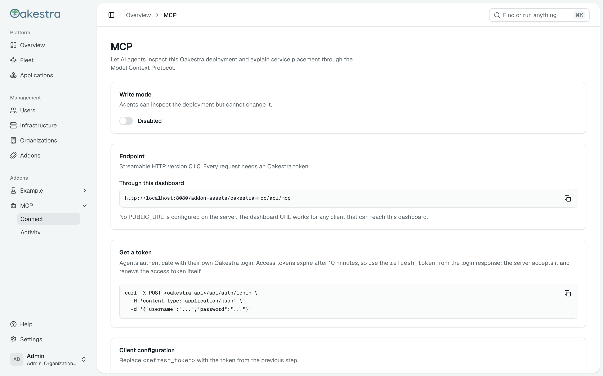
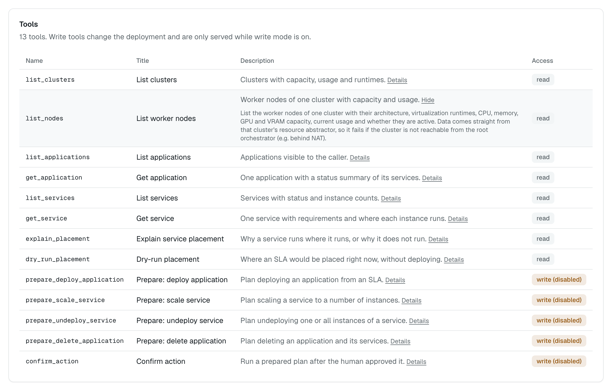
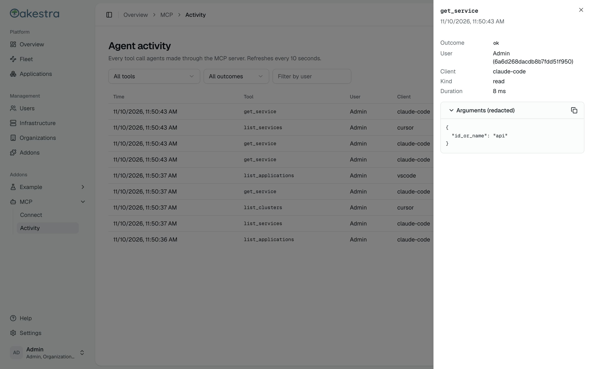
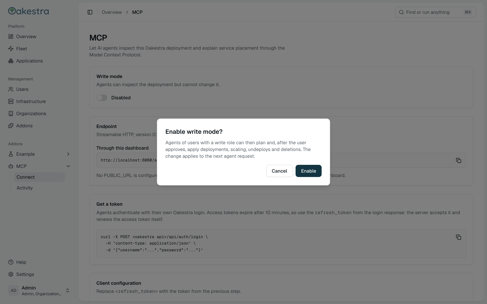

# oakestra-mcp

[](https://github.com/robertjndw/oakestra-mcp/actions/workflows/ci.yml)

MCP server for Oakestra. Agents can look at clusters, applications and services, ask why a service
landed on a given node, and (with write mode on) deploy, scale, undeploy and delete. Every change
goes through a plan that a human has to approve. It runs as an Oakestra addon and adds an MCP page
to the dashboard.



<table>
  <tr>
    <td></td>
    <td></td>
  </tr>
  <tr>
    <td align="center">Tool catalog</td>
    <td align="center">Agent activity</td>
  </tr>
</table>

## Addon / dashboard UI

The repository ships as an Oakestra addon with two services, described in `oakestra-addon.json`:
`mcp` (the Go server, port 8090) and `mcp_ui` (a small nginx image with the dashboard-v2 UI
addon from `ui/`). The UI adds an **MCP** entry to the dashboard sidebar with two pages:

- **Connect**: the write mode switch, the MCP endpoint URLs (the server's `PUBLIC_URL` if set, plus the dashboard-proxied
  `/addon-assets/oakestra-mcp/api/mcp`), how to get a token, copy-paste configs for Claude Code,
  Cursor, VS Code and generic clients, and the tool catalog with read/write badges. Each tool shows
  a short summary; click Details for the full text the agent gets.
- **Activity**: the agent call log with tool, outcome and (for Admins) user filters, paging,
  a 10 second refresh and a detail drawer with the redacted arguments.

### Install through the marketplace

Register `oakestra-addon.json` at the marketplace manager, then install it from the addons
manager (replace the host and the returned `_id`):

```sh
curl -X POST http://<root-orchestrator>:11102/api/v1/marketplace/addons \
  -H 'content-type: application/json' -d @oakestra-addon.json
curl -X POST http://<root-orchestrator>:11101/api/v1/addons \
  -H 'content-type: application/json' -d '{"marketplace_id": "<_id>"}'
```

The `ui` block (`"service": "mcp_ui"`) needs an addons engine and dashboard that support UI
addons. In `ports` the key is the container port and the value the host port. The `mcp` service
keeps its audit log in the `oakestra_mcp_data` volume. Set `PUBLIC_URL` on `mcp` if agents
should connect to a URL other than the dashboard's.

### Develop the UI

The UI depends on `@oakestra/dashboard-sdk` and `@oakestra/ui` from
[oakestra/dashboard-v2](https://github.com/oakestra/dashboard-v2), published to GitHub Packages.
GitHub Packages needs a token even for public packages, and pnpm ignores credentials in a
repository's `.npmrc`, so put a token with `read:packages` in your user config once:

```sh
gh auth refresh -s read:packages
pnpm config set //npm.pkg.github.com/:_authToken "$(gh auth token)"
```

Then:

```sh
pnpm --dir ui install
pnpm --dir ui typecheck && pnpm --dir ui test && pnpm --dir ui build
```

The dashboard is still below 1.0, so `^0.1.0` only picks up patch releases. For a new minor,
bump both packages in `ui/package.json` together. The dashboard won't load an addon built against
an SDK version it doesn't match.

For a fast loop, run the backend on `:8090`, then `pnpm --dir ui dev` (port 5181, proxies `/api`
to the backend) and, in a checkout of the dashboard, `pnpm dev:mock`, and open
<http://localhost:5173/?addon-override=oakestra-mcp=http://localhost:5181/mf-manifest.json>.

To run both services as an addon of a dashboard dev stack you already started from the
dashboard checkout (`docker compose -f compose.dev.yml up --build -d`), run
`NODE_AUTH_TOKEN=$(gh auth token) docker compose -f compose.dashboard.yml up --build -d` here. It
joins that stack's network and publishes the MCP server on port 8090. Then register the addon in
the dashboard by adding `oakestra-addon.json` to the marketplace and installing it; the comments
at the top of the file have the details. Build the UI image on its own with:

```sh
NODE_AUTH_TOKEN=$(gh auth token) docker buildx build --secret id=NODE_AUTH_TOKEN -t oakestra-mcp-ui ui
```

## Write tools

Write tools are off by default. An Admin turns them on or off with the **Write mode** switch on
the Connect page (or `PUT /settings`, see [docs/api.md](docs/api.md)); the change applies to the
next agent request without a restart and is stored in `$DATA_DIR/settings.json`.
`MCP_ENABLE_WRITES` only sets the initial value for a fresh data volume: once the setting has been
changed in the UI, the stored value wins.



Only users with the `Admin`, `Organization_Admin` or `Application_Provider` role may use the write
tools, and Oakestra still checks ownership on every call.

Every change takes two steps:

1. A `prepare_*` tool (`prepare_deploy_application`, `prepare_scale_service`,
   `prepare_undeploy_service`, `prepare_delete_application`) computes a plan from the current state
   and changes nothing. The plan lists every step, warnings and, for deploys and scale ups, a
   placement dry run. A microservice that would not be placed right now is a warning, not a refusal.
2. After the human approved the plan, `confirm_action` runs it with the `confirmation_token` from
   step 1. The token is signed, bound to the user who prepared it, valid once and only for
   `CONFIRM_TTL` (default `5m`). Confirm recomputes the plan and refuses if it changed meanwhile,
   for example because instances were added or removed. Steps run in order and stop at the first
   failure; the result says which steps were done, failed or skipped, and nothing is rolled back.

Pending actions live in `$DATA_DIR/activity.db` next to the activity log, and the signing key is
created in `$DATA_DIR/secret` (mode 0600) on first start. Deleting the key invalidates all open
tokens. Scaling counts every instance Oakestra lists for a service, whatever its status, and scales
down by removing the highest instance numbers first. New instances are scheduled asynchronously, so
check them afterwards with `get_service` or `explain_placement`.

## Container images

[`.github/workflows/ci.yml`](.github/workflows/ci.yml) runs the Go and UI tests on every push and
pull request, then builds both images for `linux/amd64` and `linux/arm64`:

| Image | Built from |
| --- | --- |
| `ghcr.io/robertjndw/oakestra-mcp` | `Dockerfile` |
| `ghcr.io/robertjndw/oakestra-mcp-ui` | `ui/Dockerfile` |

CI reads the dashboard packages with the workflow's `GITHUB_TOKEN`.

Pushes to `main` publish `latest` (what `oakestra-addon.json` pulls) and `sha-<commit>`; tags
`vX.Y.Z` also publish `X.Y.Z` and `X.Y`. Pull requests build the images without pushing them.
GHCR creates new packages as private, so make both public once after the first push, otherwise
root orchestrators need credentials to pull them.
